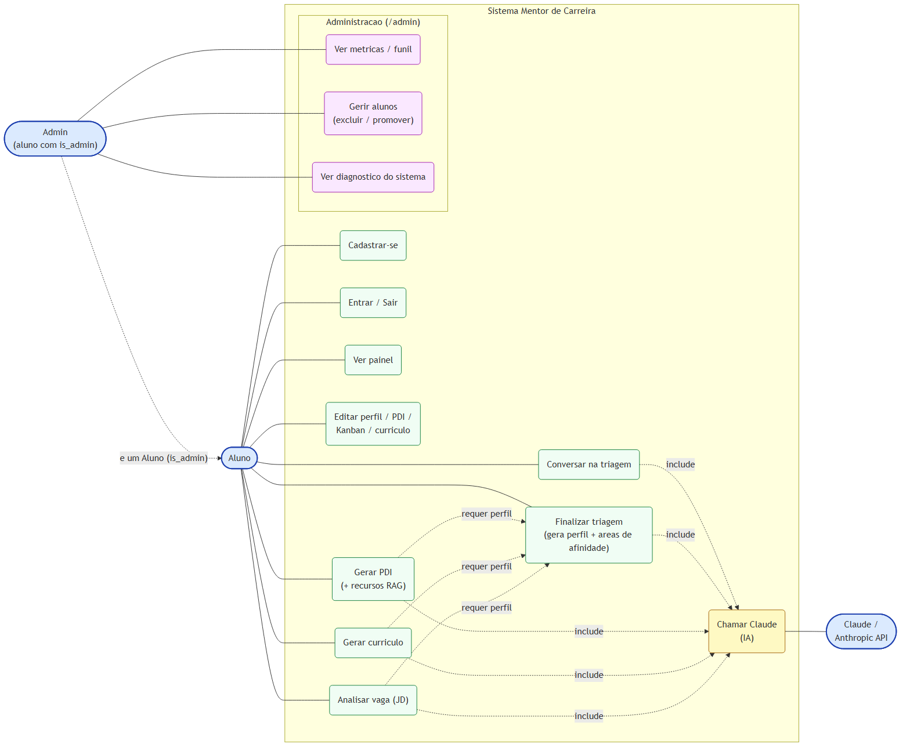
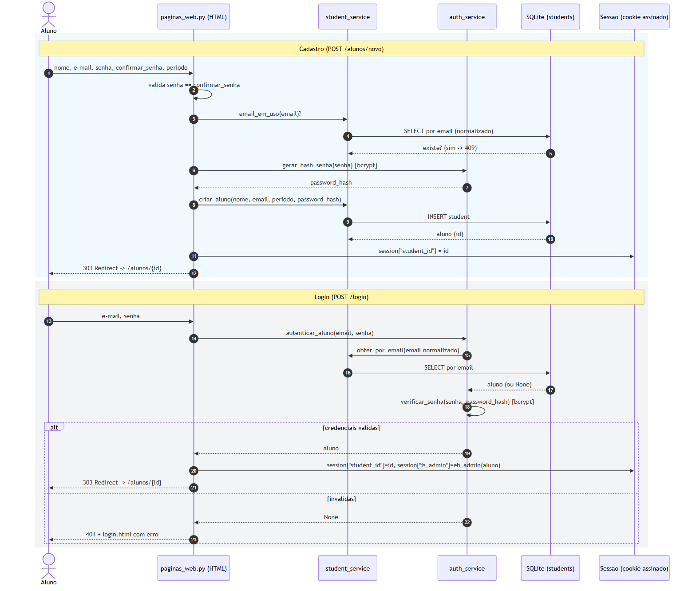
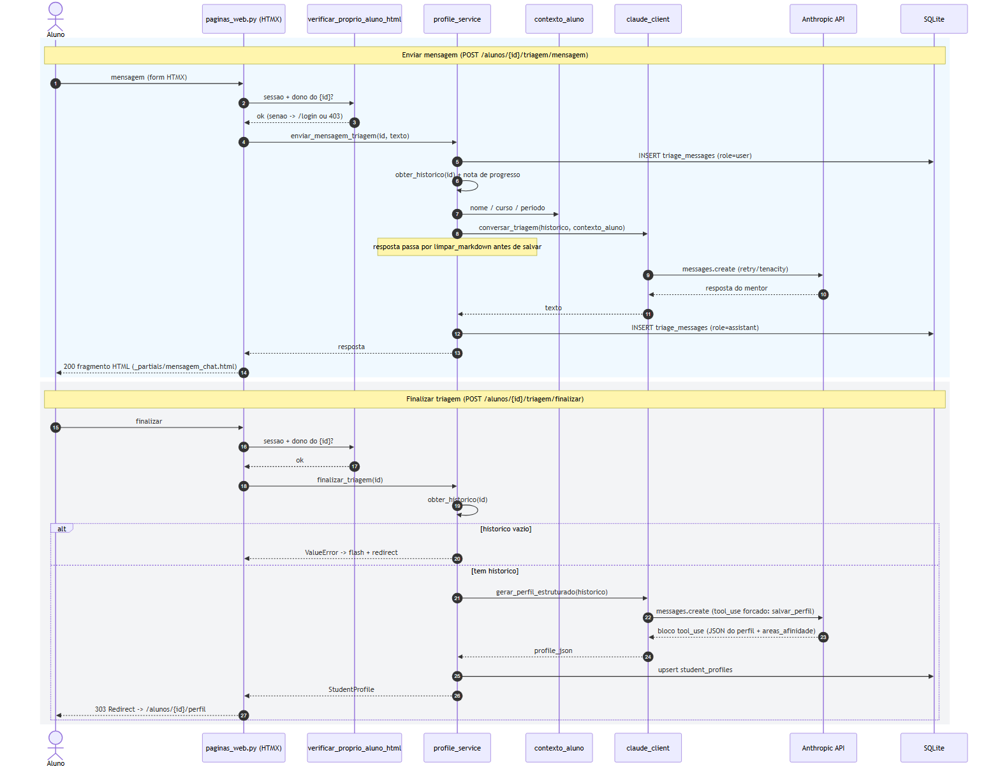
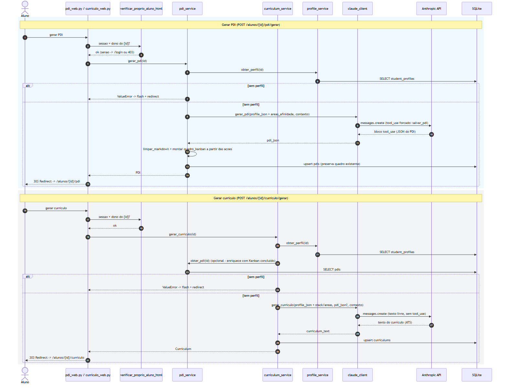
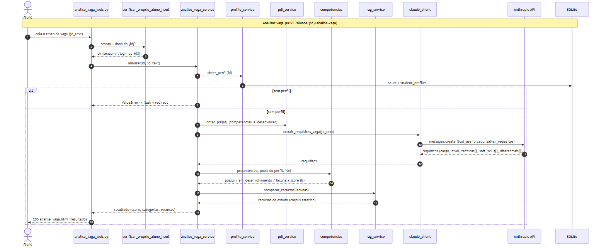
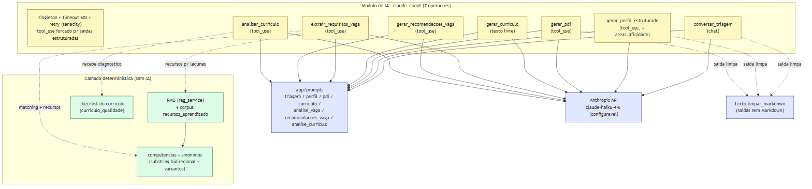
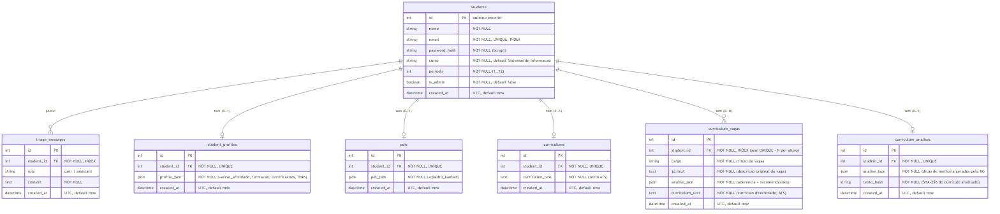
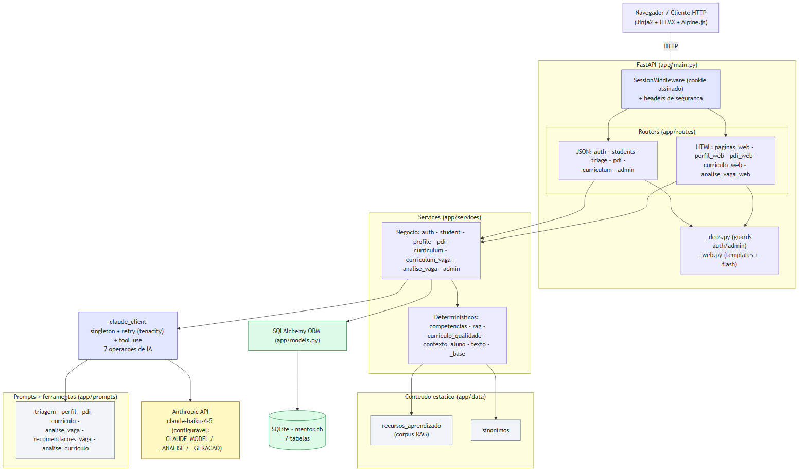

# Diagramas — Mentor de Carreira

> **Versão atual: v1.2** (junho/2026). Os diagramas refletem o sistema atual — incluindo
> painel admin, trilhas de carreira, radar de competências, RAG e Análise de Vaga.
> O estado anterior está preservado em [`v1.1/`](v1.1/) (ver [CHANGELOG](#changelog)).

Diagramas UML e o esquema do banco do sistema. Cada diagrama tem três arquivos:

- **`.mmd`** — fonte [Mermaid](https://mermaid.js.org/) (texto, versionável e editável);
- **`.svg`** — imagem vetorial (ideal para a monografia, escala sem perder qualidade);
- **`.png`** — imagem rasterizada (colável em qualquer editor de texto/slides).

As imagens são geradas a partir dos `.mmd` — edite sempre o `.mmd` e regenere (veja o final).

---

## Índice

### 1. Casos de uso — [`casos-de-uso.mmd`](casos-de-uso.mmd)
Funcionalidades sob a ótica do **Aluno** e do **Admin** (aluno com `is_admin`), além do
**Claude / Anthropic API** (sistema externo). Inclui triagem, geração de perfil/PDI/currículo,
**análise de vaga**, **edição de artefatos** e os casos de **administração** (métricas, gestão
de alunos, diagnóstico). Mostra as relações `<<include>>` dos casos que dependem da IA.



### 2. Sequência — Cadastro e Login — [`sequencia-cadastro-login.mmd`](sequencia-cadastro-login.mmd)
Autenticação por aluno: cadastro (hash bcrypt + login automático) e login por e-mail/senha,
gravando `student_id` e `is_admin` no cookie de sessão.



### 3. Sequência — Triagem e Perfil — [`sequencia-triagem-perfil.mmd`](sequencia-triagem-perfil.mmd)
Conversa de triagem via **HTMX** (`POST /alunos/{id}/triagem/mensagem`, retorna fragmento
HTML) com `contexto_aluno`, e finalização que gera o perfil via *tool use* e **recomenda a
trilha de interesse**.



### 4. Sequência — PDI e Currículo — [`sequencia-pdi-curriculo.mmd`](sequencia-pdi-curriculo.mmd)
Geração do PDI (direcionado à trilha, com **lacunas do radar** + **recursos RAG**) e do
currículo (com palavras-chave da trilha), a partir do perfil e com a guarda de autorização.



### 5. Sequência — Análise de Vaga — [`sequencia-analise-vaga.mmd`](sequencia-analise-vaga.mmd) · *novo na v1.2*
Aluno cola uma descrição de vaga → a IA **extrai os requisitos** (`extrair_requisitos_vaga`)
→ matching **determinístico** com o perfil/PDI → score de aderência, lacunas e **recursos RAG**.



### 6. Módulo de IA (componentes) — [`modulo-ia.mmd`](modulo-ia.mmd) · *novo na v1.2*
Separa o que é **IA** (as 5 operações do `claude_client`: triagem, perfil, PDI, currículo,
análise de vaga) do que é **determinístico** (competências/sinônimos, recomendador de trilhas,
radar e RAG). Complementa [`docs/MODULO_IA.md`](../docs/MODULO_IA.md).



### 7. Esquema do banco (ER) — [`esquema-banco.mmd`](esquema-banco.mmd)
Modelo entidade-relacionamento das **5 tabelas** (`students`, `triage_messages`,
`student_profiles`, `pdis`, `curriculums`) — nenhuma nova: trilhas, radar, RAG e análise de
vaga são **stateless**. Documenta também as chaves dos campos JSON. Fonte de verdade:
[`app/models.py`](../app/models.py).



### 8. Arquitetura / Componentes — [`arquitetura.mmd`](arquitetura.mmd)
Camadas do sistema: Cliente (Jinja2 + HTMX + Alpine) → FastAPI (SessionMiddleware + 11
routers) → Services (negócio + determinísticos) → `claude_client` → Anthropic API, com as
camadas `app/data` (catálogos/corpus) e `app/prompts`, e Services → SQLAlchemy ORM → SQLite.



---

## Changelog

### v1.2 (junho/2026)
- **Novos diagramas**: *Sequência — Análise de Vaga* e *Módulo de IA (componentes)*.
- **Arquitetura**: routers atuais (JSON + HTML separados), todos os serviços, camadas
  `app/data` e `app/prompts`, `claude_client` com 5 operações, modelo `claude-haiku-4-5`.
- **Casos de uso**: + ator **Admin** e casos de administração; + análise de vaga e edição.
- **Sequências**: triagem via HTMX + recomendação de trilha; PDI/currículo trilha-aware com
  radar + RAG; login grava `is_admin`.
- **Esquema do banco**: documenta as chaves JSON (`trilha_interesse`, `quadro_kanban`, etc.);
  segue com 5 tabelas.
- Estado anterior arquivado em [`v1.1/`](v1.1/).

### v1.1 (estado anterior)
5 rotas JSON, sem admin/trilhas/análise de vaga; modelo `claude-sonnet-4-6`. Preservado em
[`v1.1/`](v1.1/) como referência histórica.

---

## Como regenerar as imagens

Requer **Node.js + npm** (usa o [`mermaid-cli`](https://github.com/mermaid-js/mermaid-cli)
via `npx`, sem instalação global). A primeira execução baixa o Chromium do Puppeteer.

```powershell
# Windows (PowerShell), a partir da raiz do projeto:
./diagramas/render.ps1
```

```bash
# Com GNU Make (qualquer SO):
make diagrams
```

> O `render.ps1` processa apenas os `.mmd` da pasta `diagramas/` (não entra em `v1.1/`, que é
> um snapshot histórico). Para regenerar um único diagrama:
>
> ```bash
> npx -y @mermaid-js/mermaid-cli -i diagramas/esquema-banco.mmd -o diagramas/esquema-banco.png -b white -s 2
> npx -y @mermaid-js/mermaid-cli -i diagramas/esquema-banco.mmd -o diagramas/esquema-banco.svg -b white
> ```

> Dica: também é possível visualizar/editar os `.mmd` ao vivo no
> [Mermaid Live Editor](https://mermaid.live) ou com a extensão *Mermaid* do VS Code.
